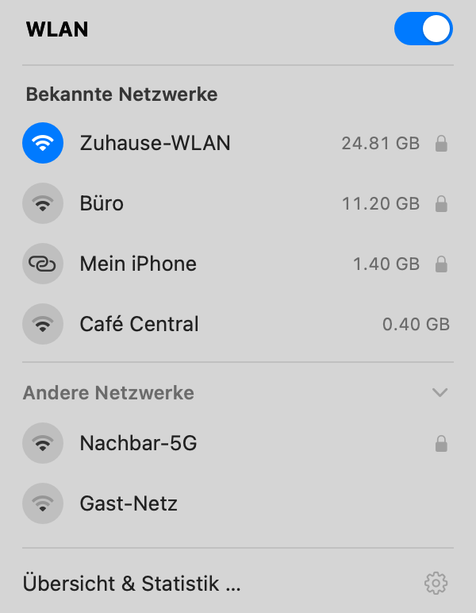
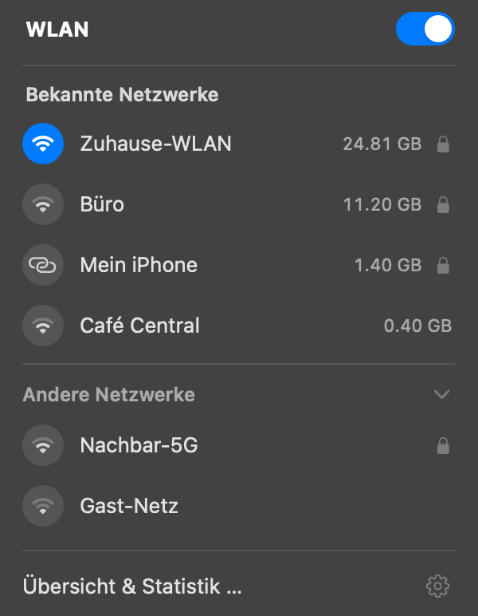
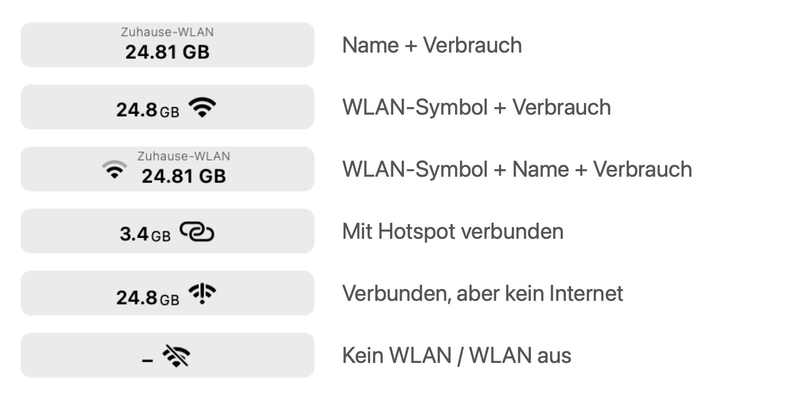
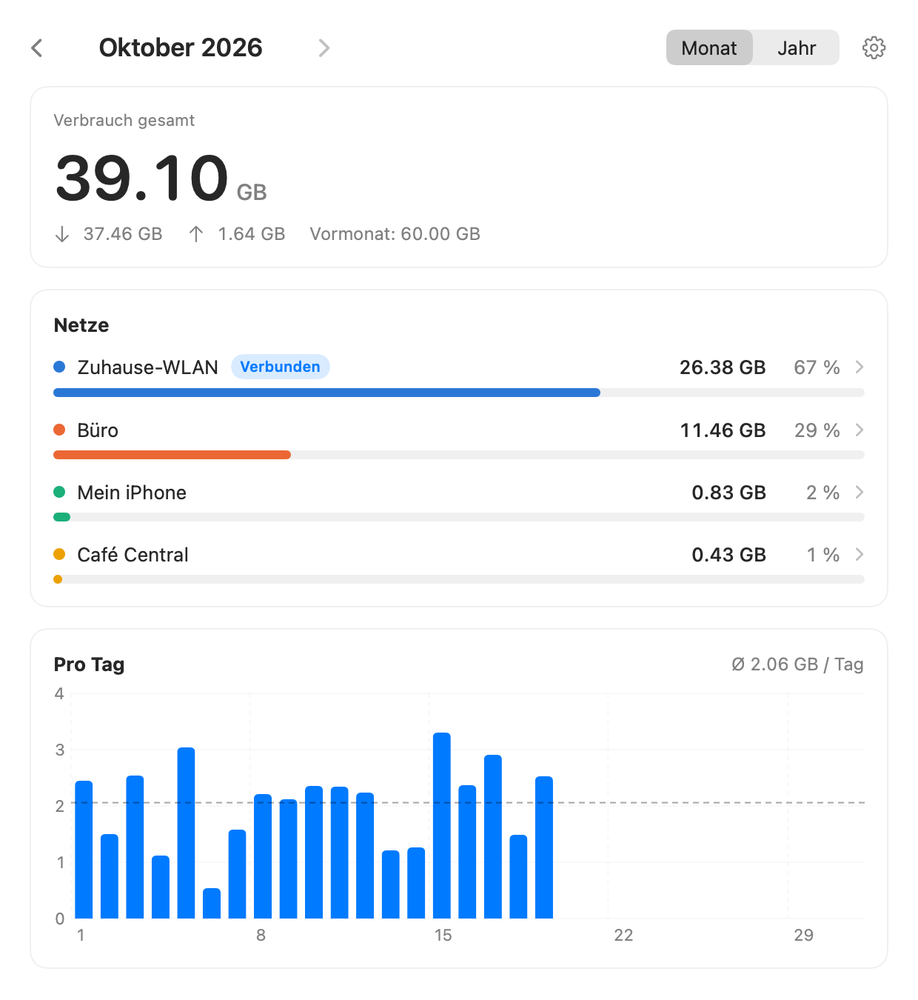
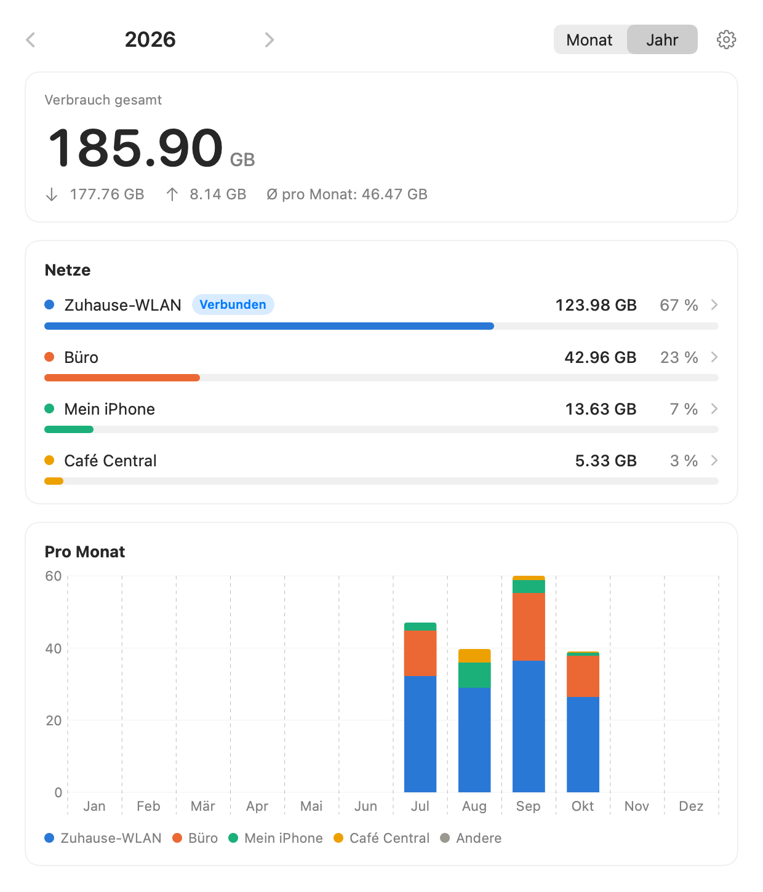
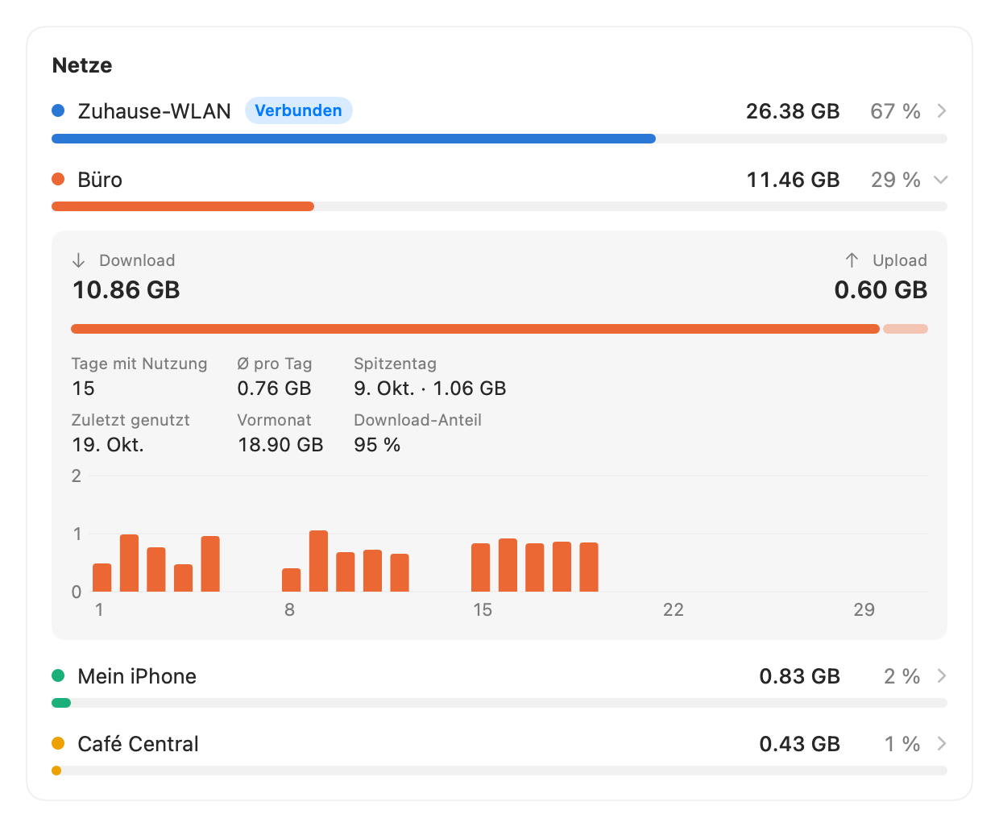
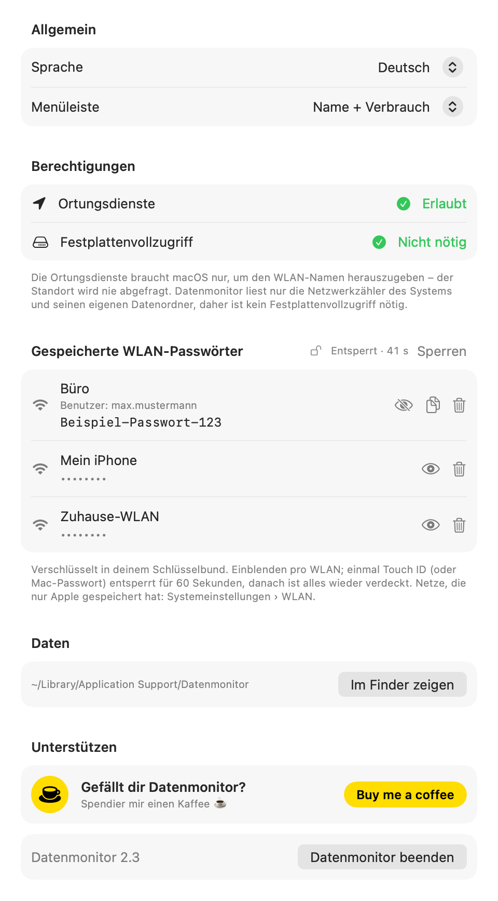
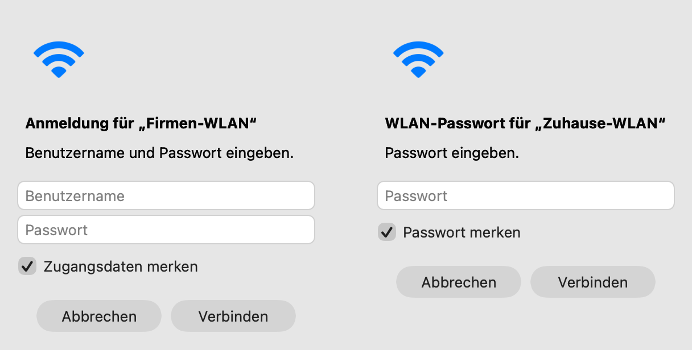
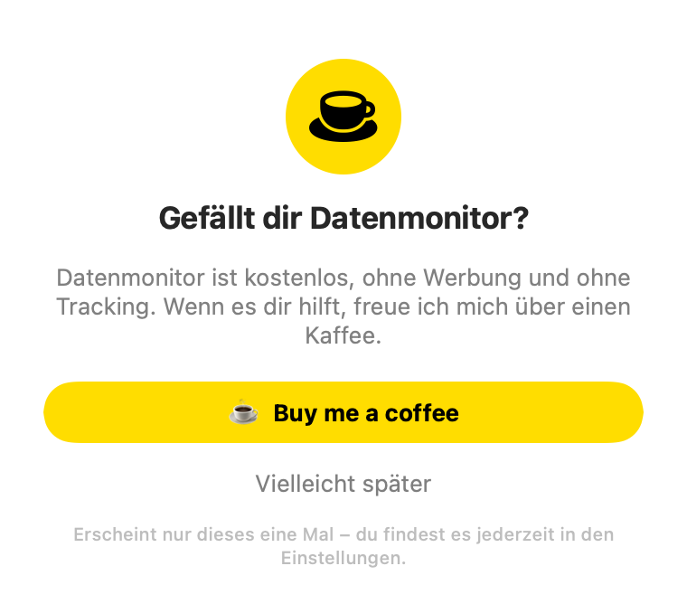

# Datenmonitor-Widget für macOS

Ein winziges Menüleisten-Widget im **Stats-Stil**: oben dünn der **echte WLAN-Name**, darunter
der Datenverbrauch (GB) dieses Netzes im laufenden Monat. Ein Klick zeigt den Verbrauch des
aktuellen WLANs und die Netze zum **Wechseln**. Die **Übersicht** (eigenes Fenster) zeigt die
Statistik zum Analysieren, das **Zahnrad** öffnet die Einstellungen (Sprache Deutsch/English,
Darstellung, Berechtigungen). Braucht **keinen Festplattenvollzugriff**.

## Screenshots

*(Alle Screenshots mit erfundenen Netzen, Werten und Zugangsdaten.)*

| Menü (hell) | Menü (dunkel) |
|---|---|
|  |  |

**Menüleiste** — wählbare Stile und Zustände:



**Übersicht** — Monat und Jahr:

| Monat | Jahr |
|---|---|
|  |  |

**Details zu einem Netz** (Klick in der Netzliste):



**Einstellungen** — mit gespeicherten WLAN-Passwörtern (pro Netz einblenden, Touch ID):



**Anmeldung** — erkennt selbst, ob nur ein Passwort oder Benutzername + Passwort nötig ist:



**Buy Me a Coffee** — erscheint einmal beim ersten Start:



## Technik

Ein einziges Swift-File, kompiliert mit Apples `swiftc` zu einer kleinen `Datenmonitor.app`. Keine Fremdsoftware, kein
SwiftBar/xbar, kein Netzwerkzugriff, keine Telemetrie. Daten rein lokal unter
`~/Library/Application Support/Datenmonitor/usage.json`.

## Dateien

- `DatenmonitorWidget.swift` — kompletter Quellcode (Widget **und** Tracker in einem)
- `install-widget.sh` — baut **einmal** die `Datenmonitor.app` und richtet den Autostart ein
- `at.datenmonitor.widget.plist` — launchd-Vorlage (Autostart nach Login)
- `AppIcon.icns` — App-Icon (Apples WLAN-Symbol in Blau, transparenter Hintergrund)

## Installation

Alle drei Dateien in denselben Ordner legen, dann im Terminal:

```bash
chmod +x install-widget.sh
./install-widget.sh
```

Das baut `~/Applications/Datenmonitor.app` (ad-hoc signiert), lädt den launchd-Agent
und startet das Widget. **Beim ersten Start fragt macOS nach den Ortungsdiensten — bitte
erlauben**, sonst gibt macOS den WLAN-Namen nicht heraus (siehe unten). Es erscheint oben rechts in der Menüleiste und startet künftig
automatisch nach dem Login — **ohne erneutes Kompilieren**. `swiftc` läuft nur beim
Ausführen des Install-Skripts, nicht bei jedem Start.

**Voraussetzung:** Apples Command Line Tools (liefern `swiftc`). Falls nicht vorhanden:

```bash
xcode-select --install
```

## Update (neuer Code)

Neuen Code in `DatenmonitorWidget.swift` einfügen, dann `./install-widget.sh`. Das Skript
entlädt die laufende Version selbst und startet die neue. Die App wird mit einer festen
Anforderung (nur Bundle-ID) signiert, daher bleibt die Ortungsdienste-Freigabe über Neubauten
erhalten. (Vor Version 2.2 ging sie bei jedem Neubau verloren — dann fehlte der WLAN-Name und
der Verbrauch landete beim falschen Netz.)

Beim Start schreibt das Widget den Ortungsstatus ins Log (`widget.err.log` im Datenordner,
Status 3 = erlaubt, 0 = noch nicht gefragt).

Laufende Version nur neu starten:

```bash
launchctl kickstart -k gui/$(id -u)/at.datenmonitor.widget
```

## Bedienung

Menüleiste (Standard): oben das aktuelle Netz, unten der Verbrauch diesen Monat. Ist das WLAN
verbunden, hat aber keinen Ausgang (kein Gateway / keine Route ins Internet), erscheint Apples
WLAN-Symbol mit Ausrufezeichen — in jedem Stil — und im Menü steht beim Netz „Keine
Internetverbindung". Das meldet macOS passiv (NWPathMonitor), das Widget sendet dafür nichts.
Mit einem Hotspot verbunden (z. B. dem iPhone) zeigt die Menüleiste statt der WLAN-Balken das
Ketten-Symbol, wie Apple. Die Farbe
passt sich automatisch an die Menüleiste an (dunkel bei heller Leiste, hell bei dunkler).

Klick öffnet ein Menü im Stil des macOS-WLAN-Menüs (siehe Screenshots oben):

- **Schalter** oben schaltet das WLAN ein/aus (blau = an).
- **Hotspots** stehen mit Ketten-Symbol in derselben Liste „Bekannte Netzwerke“ — nur wenn sie
  gerade in Reichweite sind (wie alle Netze). Ein schlafender iPhone-Hotspot lässt sich nur über
  Apples Instant Hotspot aufwecken — das ist für fremde Apps gesperrt.
- Beim Öffnen sucht das Widget sofort neu (kleiner Warte-Kreis neben dem Schalter); Netze, die
  nicht mehr gefunden werden, verschwinden nach 30 Sekunden.
- **Bekannte Netzwerke:** nur gespeicherte Netze, die gerade in Reichweite sind (stärkstes Signal zuerst), das verbundene oben mit blauem Kreis. Rechts
  steht jeweils der Verbrauch dieses Monats (Maus darüber = Download/Upload). Hotspots erkennt
  das Widget am Namen (iPhone/iPad/Android/Hotspot) bzw. an der typischen Hotspot-Adresse.
- **Andere Netzwerke:** immer sichtbar und auf-/zuklappbar wie bei Apple; zeigt nicht
  gespeicherte Netze in Reichweite oder „Keine weiteren Netzwerke" (frische Netzsuche;
  kurz nicht gefundene Netze bleiben 30 Sekunden stehen, damit schwache Netze nicht flackern), per Klick auf- und
  zuklappbar (das Menü bleibt dabei offen). Klick auf ein Netz verbindet; bei geschützten
  Netzen fragt Datenmonitor nach dem Passwort und verbindet über CoreWLAN.
- Klick auf ein Netz verbindet, Klick auf das verbundene öffnet die Übersicht. Beim Wechseln
  und beim Ein-/Ausschalten bleibt das Menü offen: Im Symbolkreis des Netzes dreht sich ein
  Warte-Kreis, in der Menüleiste laufen die WLAN-Balken (wie bei Apple), danach rückt der
  blaue Kreis um.
- **Bekannte Netze verbinden:** Datenmonitor nutzt dieselbe interne Schnittstelle wie Apples
  WLAN-Menü (CoreWiFi) und verbindet über das gespeicherte Netzprofil, meist in unter einer
  Sekunde.
  - **Offene Netze** (z. B. Café-WLAN): ganz ohne Abfrage.
  - **Geschützte Netze** (WPA, z. B. A1, Gast, iPhone-Hotspot): Beim ersten Wechsel fragt
    Datenmonitor einmal nach dem **WLAN-Passwort** (nicht dem Mac-Passwort). Mit „Passwort merken"
    wird es als eigener Eintrag in deinem **Anmelde-Schlüsselbund** gespeichert — verschlüsselt,
    ohne Rückfrage lesbar nur für Datenmonitor, nie in Dateien, Log oder Befehlszeilen, und erst
    nachdem die Verbindung damit geklappt hat. Danach wechselt ein Klick ohne Abfrage (über die
    öffentliche CoreWLAN-Schnittstelle). Hat sich das Passwort geändert, steht „Passwort prüfen –
    nochmal klicken"; das alte wird erst ersetzt, wenn das neue funktioniert. Verwalten und
    löschen: Einstellungen › Gespeicherte WLAN-Passwörter.
  - **Was ein Netz verlangt, erkennt Datenmonitor selbst** — der Reihe nach aus der aktuellen
    Suchliste, dem System-Zwischenspeicher, dem von macOS gespeicherten Profil und zuletzt einer
    gezielten Suche: offen oder OWE („Enhanced Open", verschlüsselt ohne Passwort) → keine
    Abfrage; WPA/WPA2/WPA3-Personal → nur Passwort; Enterprise → Benutzername + Passwort.
  - **Enterprise-Netze** (WPA2/WPA3-Enterprise, 802.1X — z. B. Schule, Uni, Firma, eduroam):
    Die Abfrage hat dann zusätzlich ein Feld **Benutzername**. Benutzername und Passwort werden
    gemeinsam im selben verschlüsselten Schlüsselbund-Eintrag gespeichert und über Apples
    Enterprise-Schnittstelle verbunden (ohne Zertifikat-Identität; Netze, die ein eigenes
    Nutzerzertifikat verlangen, gehen weiter über Apples Menü).
  - In alle Felder lässt sich mit **⌘V einfügen** (auch ⌘C, ⌘X, ⌘A, ⌘Z) — dafür hat die App ein
    unsichtbares „Bearbeiten“-Menü, weil Menüleisten-Apps sonst keine dieser Tastenkürzel haben.
  - **Die Abfrage selbst ist bewusst kurz** („Passwort eingeben.“ bzw. „Benutzername und
    Passwort eingeben.“, dazu „merken“). Was beim Merken passiert: Die Zugangsdaten landen
    verschlüsselt in deinem Anmelde-Schlüsselbund, ohne Rückfrage lesen kann sie nur
    Datenmonitor, und gespeichert wird erst, wenn die Verbindung damit geklappt hat.
    Alle Zugangsdaten liegen zusammen in **einem** Eintrag („Datenmonitor – WLAN-Zugangsdaten“).
    Der Schlüsselbund bindet die Freigabe an genau diese Programmversion: Nach einem Update fragt
    macOS **einmal** nach (nicht pro Netz) — Mac-Passwort eingeben, „Immer erlauben“ wählen.
    Danach liest Datenmonitor den Eintrag einmal und arbeitet aus dem Speicher. Lehnst du die
    Abfrage ab, fragt Datenmonitor bis zum nächsten Start (oder bis du die Einstellungen öffnest)
    nicht erneut — es gibt keine Abfrage-Schleife. Prüfung und Schlüsselbund laufen im
    Hintergrund, das Menü friert dabei nicht ein. Einzeleinträge
    älterer Versionen (bis 2.2) werden beim ersten Zugriff übernommen und gelöscht.
    (Eine feste eigene Signatur würde das vermeiden, macht den Signierschlüssel aber zu einem
    Einfallstor: Wer damit signieren darf, könnte die Passwörter ohne Rückfrage lesen.)
  Die Schnittstelle ist privat und undokumentiert: Ändert Apple sie mit einem macOS-Update,
  zeigt das Menü „Fehlgeschlagen" und man wechselt über Apples Menü.
  (`networksetup` scheitert seit macOS 14 mit „Could not find network" bzw. Fehler -3900.)
  Klappt es mit dem zwischengespeicherten Suchergebnis nach 5 Sekunden nicht, versucht es das
  Widget einmal mit frischer Suche. Jeder Wechsel öffnet eine frische Verbindung zum WLAN-Dienst
  (eine lange gehaltene wird nach Ruhezustand oder WLAN aus/an still ungültig) und schreibt
  Start, Ergebnis und Dauer ins Log (`widget.err.log`).
- Ob das Verbinden geklappt hat, prüft das Widget am Ergebnis (ist man nach höchstens
  15 Sekunden in diesem WLAN?), nicht an der Rückmeldung von macOS. Klappt es nicht, steht
  beim Netz kurz der Grund („Nicht in Reichweite" bzw. „Fehlgeschlagen") — kein Popup. Wählt man zwischendurch ein anderes Netz,
  zählt nur der letzte Klick.
- Schnell: Das Menü öffnet ohne Systembefehle (letzte Messung, gemerkte Netze), der Schalter
  reagiert sofort, und nach dem Einschalten stehen die zuletzt gesehenen Netze gleich da,
  während die Suche im Hintergrund aktualisiert.
- Unten links **Übersicht & Statistik**, rechts das **Zahnrad** für die Einstellungen (jeweils
  mit eigenem Hover).

### Übersicht

- Oben mit **‹ ›** blättern, daneben **Monat | Jahr** umschalten, rechts das **Zahnrad** zu
  den Einstellungen.
- **Jahresansicht:** Gesamtverbrauch des Jahres mit Vorjahr und Ø pro Monat, Netze des Jahres
  (Details dann pro Monat: Monate mit Nutzung, Ø pro Monat, Spitzenmonat), „Pro Monat“
  (Jän–Dez, gestapelt nach Netz) und „Jahre im Vergleich“, sobald es mehrere Jahre gibt.
- **Verbrauch gesamt** als große Zahl, darunter Download, Upload und der Vormonat.
- **Netze:** jedes Netz mit Farbpunkt, Anteilsbalken, GB und Prozent; das verbundene ist
  markiert. Netze unter 0.01 GB werden zusammengefasst. **Klick auf ein Netz** klappt
  Details auf: Download und Upload (mit Verhältnisbalken), Tage mit Nutzung, Ø pro Tag,
  Spitzentag, zuletzt genutzt, Vormonat, Download-Anteil und ein Tagesdiagramm nur für
  dieses Netz. Werte mit * beziehen sich nur auf Tage mit Tageszählung (seit 17. Okt. 2026);
  was davor lag, nennt eine Fußnote.
- **Pro Tag:** Verbrauch je Tag mit Durchschnittslinie (Ø pro Tag), Maus darüber = Wert des
  Tages. Wird seit Oktober 2026 aufgezeichnet.
- Jedes Netz behält überall dieselbe Farbe (die fünf größten Netze aller Zeit; der Rest grau
  als „Andere"). Die Palette ist auf Farbenblindheit geprüft.

### Einstellungen (Zahnrad)

- **Sprache:** „Wie das System" (Standard), Deutsch oder English — wirkt sofort auf
  Menüleiste, Menü und alle Fenster.
- **Menüleiste:** „Name + Verbrauch" (Standard), „WLAN-Symbol + Name + Verbrauch",
  „WLAN-Symbol + Verbrauch" (kompakt: z. B. **1.1**GB 📶 — Zahl kräftig, „GB" klein auf
  derselben Grundlinie, rechts Apples WLAN-Symbol), „Nur Verbrauch" oder „Nur WLAN-Symbol" (Signalstärke,
  durchgestrichen = nicht verbunden/aus).
- **Berechtigungen:** Status der Ortungsdienste (mit Knopf zum Erlauben). Festplattenvollzugriff
  ist **nicht nötig**: Das Widget liest nur die Netzwerkzähler des Systems (`netstat`, `arp`,
  `networksetup`) und seinen eigenen Ordner unter `Application Support`.
- **Gespeicherte WLAN-Passwörter:** alle Netze, deren Zugangsdaten in Datenmonitor gespeichert
  sind — Passwort und ggf. Benutzername zunächst verdeckt. Jedes Netz hat ein **Auge zum Ein-
  und Ausblenden**. Das erste Einblenden fragt nach **Touch ID** (ersatzweise Mac-Passwort) und
  entsperrt für **60 Sekunden**: In der Zeit lassen sich beliebige Netze ohne neue Abfrage ein-
  und ausblenden (oben „Entsperrt · 41 s“ und „Sperren“). Danach oder beim Schließen des Fensters
  ist alles wieder verdeckt, das nächste Einblenden fragt erneut. Kopieren legt das Passwort in die Zwischenablage und leert sie nach
  60 Sekunden wieder. Einzelne Einträge lassen sich löschen. (Passwörter, die nur Apple
  gespeichert hat: Systemeinstellungen › WLAN › Netz › „Passwort kopieren“.)
- **Daten:** Datenordner im Finder zeigen.
- **Unterstützen:** Buy-Me-a-Coffee-Knopf, dazu Version und „Datenmonitor beenden".

Beim allerersten Start erscheint einmal ein kleines **Buy-Me-a-Coffee-Fenster**
(„Vielleicht später" oder Fenster schließen genügt; danach nur noch in den Einstellungen).

Tipp: Mit einem Stil mit WLAN-Symbol kann man das System-WLAN-Symbol ausblenden:
Systemeinstellungen → Kontrollzentrum → WLAN → „In der Menüleiste nicht anzeigen".

**WLAN wechseln:** Die Netzsuche läuft beim Öffnen des Menüs im Hintergrund; die Liste
aktualisiert sich, sobald sie fertig ist. Ein Klick verbindet mit `networksetup`, das
Passwort kommt aus dem Schlüsselbund. Klappt das nicht, bietet ein Hinweis direkt die
WLAN-Einstellungen an.

## Wie es zählt

Alle 20 Sekunden liest das Widget die kumulativen Byte-Zähler der WLAN-Schnittstelle
(`netstat -ibn`, Link-Layer-Zeile, IPv4+IPv6 zusammen), bildet die Differenz zur letzten
Messung und schreibt sie dem aktuellen Netz im aktuellen Monat und Tag gut.

**Netz-Erkennung über den echten Namen:** Seit macOS 14.4 gibt das System den WLAN-Namen
(SSID) nur an Apps mit Ortungsdienste-Zugriff heraus. Deshalb ist das Widget eine echte
(kleine) App mit Bundle-ID und fragt einmal nach den Ortungsdiensten. Der Standort selbst
wird nie abgefragt — die Freigabe ist nur der Schlüssel zur SSID (CoreWLAN).

Gezählt wird pro **SSID**. Zusätzlich merkt sich das Widget, welche **Router-MAC** (via
`arp`) zu welcher SSID gehört. Dadurch laufen ältere Einträge, die vor der Freigabe nur
unter der Router-MAC gezählt wurden, automatisch unter dem echten Namen zusammen, sobald
man das Netz wieder betritt. Die Zuordnung wird nur **einmal** gelernt: Haupt- und
Gast-WLAN hängen oft am selben Router, und die alten Daten sollen nicht bei jedem Wechsel
zwischen beiden mitwandern. Ohne Freigabe gilt die alte Heuristik: Gateway `172.20.10.x`
→ „iPhone-Hotspot", `192.168.43.1` → „Android-Hotspot", sonst „WLAN ·<MAC-Ende>".

Liefert `arp` kurz keine Router-MAC (z. B. direkt nach dem Verbinden), bleibt das Widget
bei der MAC derselben Verbindung, statt auf die Gateway-IP auszuweichen. Früher landete der
Verbrauch dann unter Schlüsseln wie `172.20.10.1` oder `wlan`, und Name und Statistik passten
nicht mehr zusammen. Solche Alt-Einträge erscheinen als „Unbekanntes WLAN" bzw. „iPhone-Hotspot".

- **Neustart/Reboot:** Der Roh-Zähler springt zurück; das wird erkannt (kein Fehlzählen).
- **Monatswechsel:** automatisch, alte Monate bleiben im Untermenü einsehbar.
- **Kein WLAN:** wird nicht gezählt.

## Anpassen (im Quellcode, oben in der Datei)

- `SAMPLE_INTERVAL` — Messintervall in Sekunden (Standard 20).

In `render`:

- Schriftgröße: die Zahlen hinter `ofSize:` (obere Zeile / untere Zeile).
- Dicke: `weight:` (`.regular`, `.medium`, `.semibold`, `.bold`).
- WLAN-Symbol: `SymbolConfiguration(pointSize:)`; Schwellen der Signalbalken in `Wifi.level`.
- Farbe: `topColor` / `botColor`. `img.isTemplate = true` lässt die Farbe automatisch der
  Menüleiste folgen; für eine feste eigene Farbe `isTemplate` auf `false` setzen und in
  `topColor`/`botColor` z. B. `NSColor(calibratedRed:green:blue:alpha:)` verwenden.

## Buy Me a Coffee einrichten

1. Auf [buymeacoffee.com](https://buymeacoffee.com) „Start my page" wählen und registrieren
   (E-Mail oder Google). Dabei einen **Benutzernamen** festlegen — deine Seite heißt dann
   `https://buymeacoffee.com/<benutzername>`.
2. Seite kurz ausfüllen: Profilbild, ein Satz zu Datenmonitor, Preis pro Kaffee (z. B. 3 €).
3. **Auszahlung verbinden** (in deinem BMC-Dashboard unter den Auszahlungs-/Payout-Einstellungen,
   über Stripe Express). **Ohne verbundene Auszahlung ist die Seite versteckt** — Besucher sehen
   nur „Follow", aber keinen Bezahlknopf. Erst sammeln und später verbinden geht also nicht. Buy Me a Coffee
   behält laut eigener Angabe eine kleine Gebühr (rund 5 %) plus Zahlungsgebühren ein.
4. In `DatenmonitorWidget.swift` ganz oben den Link eintragen:

   ```swift
   let COFFEE_URL = "https://buymeacoffee.com/deinname"
   ```

   Aktuell eingetragen: `https://buymeacoffee.com/suntinger`.

5. Neu bauen: `./install-widget.sh`. Testen über Zahnrad → Einstellungen → „Buy me a coffee".

Das Coffee-Fenster vom ersten Start noch einmal sehen (zum Testen):

```bash
defaults delete at.datenmonitor.widget coffeeSeen
```

```bash
launchctl kickstart -k gui/$(id -u)/at.datenmonitor.widget
```

## Bekannte Einschränkungen

- **WLAN-Name:** Ohne Ortungsdienste-Freigabe zeigt macOS die SSID nicht; dann greift die
  Heuristik/MAC-Bezeichnung. Im Menü steht in dem Fall „WLAN-Namen anzeigen: Ortungsdienste
  erlauben …".
- **Netze mit gleichem Namen** (z. B. überall „Gast") werden zusammengezählt.
- **Haupt- und Gast-WLAN am selben Router:** gezählt wird nach WLAN-Namen. Fehlt der Name
  kurz (z. B. während einer Netzsuche), gilt der Name der laufenden Verbindung; nur wenn er
  gar nicht bekannt ist, landet der Verbrauch bei „Unbekanntes WLAN" statt geraten zu werden.
- **WLAN wechseln:** nur Netze in Reichweite; versteckte Netze (ohne SSID-Aussendung) und
  Firmen-WLANs mit Benutzername (802.1X) über die WLAN-Einstellungen. Ohne
  Ortungsdienste-Freigabe findet die Suche keine Netze.
- **Persönlicher Hotspot:** Apples „Instant Hotspot" (iPhone ohne aktives WLAN) ist für
  fremde Apps nicht erreichbar; das Widget zeigt Hotspots nur, wenn sie gerade senden.
- **Umbenennen** gibt es nicht mehr: angezeigt wird immer der echte WLAN-Name.
- **Sprachen:** Deutsch und Englisch; bei jeder anderen Systemsprache erscheint Englisch.
- **Genauigkeit:** Interface-Zähler erfassen allen Verkehr auf der Leitung (inkl. Overhead);
  der Providerwert kann um wenige Prozent abweichen.
- **GiB:** gerechnet wie im Finder (1 GB = 1 073 741 824 Byte).

## Zusammenspiel mit LuLu

Das Widget zählt nur und öffnet keine Verbindungen (LuLu fragt also nie nach). LuLu bleibt
für die Kontrolle ausgehender Verbindungen zuständig, das Widget zeigt den Verbrauch.

## Entfernen

```bash
launchctl bootout gui/$(id -u)/at.datenmonitor.widget
rm -rf ~/Applications/Datenmonitor.app
rm ~/Library/LaunchAgents/at.datenmonitor.widget.plist
rm -rf ~/Library/Application\ Support/Datenmonitor   # optional: Daten löschen
```